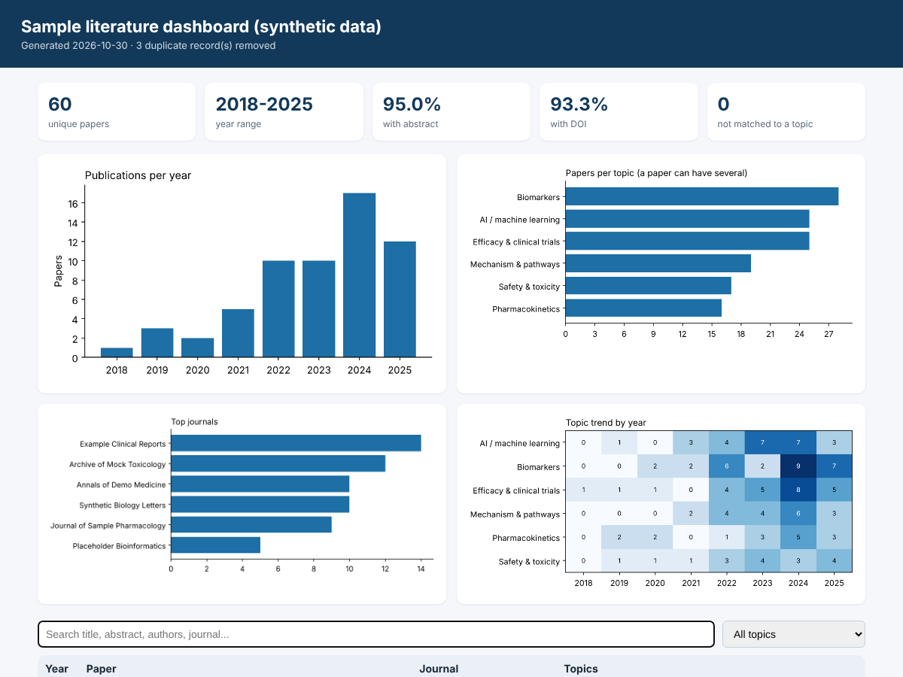

# Literature mining dashboard

Search PubMed, clean and tag the results, and turn them into a **searchable dashboard (HTML)** and a **PDF reference report** that a team can read without running any code.

```
PubMed query --esearch/efetch--> parsed records --dedupe + topic tags--> dashboard.html + literature_report.pdf
```



> **The files in `sample_data/` and `output/` use synthetic records, not real publications.** Every title starts with `[SAMPLE]`, PMIDs are in the 9xxxxxxx range, DOIs use a made-up prefix and the journals are fictional. They exist to demonstrate and test the pipeline.

## Quick start

```bash
pip install -r requirements.txt

# 1. try it on the bundled sample data
python build_dashboard.py --input sample_data/pubmed_sample.xml --out-dir output

# 2. run it on a real PubMed query
python pubmed_client.py "nitrosamine AND mutagenicity" --max 300 --mindate 2018 --out data/records.json
python build_dashboard.py --input data/records.json --out-dir output --title "Nitrosamine literature"

# 3. tests (offline)
pytest -q
```

Open `output/dashboard.html` in any browser. It is one self-contained file: charts, a text search box, a topic filter and sortable columns.

## What is in the box

| File | Purpose |
|---|---|
| `pubmed_client.py` | NCBI E-utilities client: esearch, batched efetch, XML parsing, retries and rate limiting |
| `analyze_literature.py` | De-duplication (DOI, then PMID, then title), keyword topic tagging, summary tables |
| `build_dashboard.py` | Builds the HTML dashboard and the PDF report |
| `test_literature_pipeline.py` | 14 offline tests (parsing edge cases, dedupe, tagging, batching, outputs) |
| `sample_data/generate_sample_xml.py` | Generates the synthetic PubMed-format XML used for demos and tests |

## Design decisions

- **Offline-testable.** The HTTP layer is injected (`fetch=`), so the full pipeline is tested with a fake NCBI instead of the live service.
- **Real PubMed edge cases are handled and tested:** structured abstracts, `MedlineDate` instead of `Year`, inline markup such as `<i>` inside titles, missing abstracts and DOIs, and duplicate records for the same DOI.
- **Auditable tagging.** Topics are plain keyword lists (edit `DEFAULT_TOPICS` or pass `--topics topics.json`). Keywords match from the start of a word, so `hepatotox` catches "hepatotoxicity" but not "unsafety". This is a first-pass screen and a person should review what it flags.
- **Safe HTML.** Paper text is inserted with `textContent` and the embedded JSON is escaped, so abstract text cannot inject markup.
- **PDF text.** The built-in PDF fonts cover Latin-1 only, so symbols such as the Greek letters are transliterated (for example `beta`).
- **Polite to NCBI.** About 3 requests per second by default. Set `NCBI_EMAIL` and optionally `NCBI_API_KEY` (higher rate limit) in your environment.

## Custom topics

```json
{
  "Safety": ["adverse event", "toxicity", "mutagen"],
  "Biomarkers": ["biomarker", "signature"]
}
```

```bash
python build_dashboard.py --input data/records.json --topics topics.json
```

## Status and limits

- Parsing, de-duplication, tagging, charts, HTML and PDF are tested on synthetic PubMed-format XML.
- The live E-utilities calls (`pubmed_client.py` against ncbi.nlm.nih.gov) follow the documented API and are unit-tested with a fake HTTP layer, but have **not yet been run against the live service from the test environment**. Run the quick-start query once and open an issue if the response format differs.
- Only titles, abstracts and metadata are processed. Full-text PDFs are not downloaded or redistributed.
- Not covered yet: Europe PMC / Scopus sources, PDF export of the table, scheduled refreshes.

## Next steps

- Add Europe PMC and Crossref as extra sources behind the same record format.
- Store records in SQLite so repeated runs only fetch new PMIDs.
- Add an LLM-assisted summary step with a human review column.
